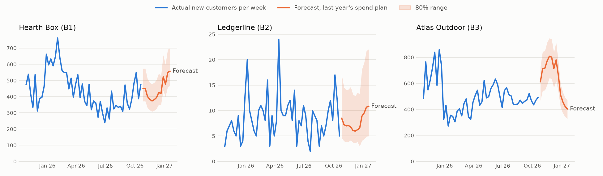

# Forecasting (SYNTHETIC data)

## Summary for management

1. **Business question.** If each business keeps last year's spending pattern, what will the next quarter
   (26 Oct 2026–24 Jan 2027) and the next 12 months bring in spend, leads, customers, acquisition
   cost, revenue and contribution profit? And how far off could that be?
2. **Why it matters.** The quarter ahead includes B3's Black Friday and Christmas peak and B1's January peak.
   Finance needs a range, not a point, to plan cash. This forecast is also the "do nothing different"
   baseline that the optimised budget in phase 4 has to beat.
3. **What this establishes.** Five methods were tested the way they would have been used: at 10 points in the
   last year, each forecast the following 13 weeks using only the data available at the time. A seasonal
   regression that knows the spend plan was the most accurate for 12 of 12 funnel
   forecasts. The machine-learning model beat it in 1 of 24 cases. Quarterly totals of new
   customers were accurate to within 3%–19% on average, and contribution profit to
   within 1%–3%.
4. **In business terms.** Baseline next quarter, with the realistic downside–upside range:
   - **B1:** 5,736 new customers (range 5,503–6,660), blended CAC $40 ($34–$41), contribution profit $0.31M ($0.30M–$0.31M)
   - **B2:** 126 new customers (range 101–145), blended CAC $892 ($774–$1,111), contribution profit $1.37M ($1.35M–$1.41M)
   - **B3:** 8,281 new customers (range 7,730–8,483), blended CAC $20 ($20–$21), contribution profit $0.35M ($0.34M–$0.36M)

   Across the group, next-12-month contribution profit is about $8.3M
   ($8.2M–$8.5M).
5. **Action to consider.** Plan on quarterly totals, not weekly figures: B2's weekly sign-ups are too few to
   forecast closely, and no method can do much better. Use the pessimistic case for cash planning. Do **not**
   use the forecasting model to decide how much to spend. Its spend coefficients say a 1% rise in spend lifts
   customers by between 1.30 and 1.33 without controls and 0.59–0.83 with them, and that is a correlation with budgets that followed demand, not the effect of the
   spend.
6. **Assumptions and limits.** Forecasts assume the next year behaves like the last two to three. The spend plan
   is last year's, week by week. Ranges come from only 10 historical test points, so the 10% and 90% cases
   are rough. The 80% weekly ranges contained the actual value 75% of the time when tested on
   held-out periods, so they are slightly too narrow. The 12-month range applies the quarterly error to the
   whole year (an assumption).

## What is forecast, and from what

Weekly per business, from `business_week_pnl` (SQL layer): spend, clicks, leads (B2 de-duplicated), qualified
leads, new customers, revenue and contribution from all active customers, and contribution profit
(contribution − one-off acquisition costs − ad spend). **CAC** is planned spend ÷ forecast customers, a
*blended* CAC that includes organic customers. It is not the incremental CAC that budget decisions need.

| Model | How it works | Uses the spend plan |
|---|---|---|
| naive | next weeks = last week | no |
| seasonal_naive | next weeks = same weeks last year | no |
| ets | Holt-Winters: damped trend + 52-week seasonality, log scale | no |
| regression | trend + 3 annual sine/cosine pairs + log spend this week and last, log scale | yes |
| gbm | gradient-boosted trees on the de-trended series: seasonality, last year's value, spend | yes |
| regression_spend_forecast | the regression, with spend replaced by a seasonal-naive *forecast* of spend | no |

Spend is a management decision, so the spend-aware models forecast *given the plan*; in testing, the actual
spend stands in for the plan. The last row shows what that knowledge is worth.

## How the methods were tested (rolling origin)

Origins every 4 weeks from week 104. At each origin, models are fitted on all earlier weeks and
forecast the next 13: 10 origins × 13 horizons per series. **WAPE** = total absolute error ÷ total actual
(comparable across series of different size). **Bias** = total error ÷ total actual (positive = forecasts too
high). MAE and RMSE are in `reports/tables/forecast_accuracy.csv`.

### Weekly WAPE by method

Lower is better. The selected model is the simplest within 5% (relative) of the best.

| business   | target              |   naive |   seasonal_naive |   ets |   regression |   gbm |   regression_spend_forecast |
|:-----------|:--------------------|--------:|-----------------:|------:|-------------:|------:|----------------------------:|
| B1         | cac                 |   0.302 |            0.149 | 0.136 |        0.129 | 0.138 |                       0.137 |
| B1         | clicks              |   0.094 |            0.103 | 0.087 |        0.030 | 0.041 |                       0.096 |
| B1         | contribution_profit |   0.144 |            0.111 | 0.114 |        0.061 | 0.079 |                       0.113 |
| B1         | customers           |   0.288 |            0.167 | 0.145 |        0.127 | 0.140 |                       0.134 |
| B1         | leads               |   0.267 |            0.167 | 0.132 |        0.100 | 0.122 |                       0.121 |
| B1         | qualified_leads     |   0.274 |            0.160 | 0.134 |        0.116 | 0.132 |                       0.126 |
| B1         | revenue             |   0.061 |            0.057 | 0.047 |        0.031 | 0.040 |                       0.031 |
| B1         | spend               |   0.124 |            0.140 | 0.122 |        0.129 | 0.156 |                     nan     |
| B2         | cac                 |   0.544 |            0.595 | 0.510 |        0.416 | 0.458 |                       0.405 |
| B2         | clicks              |   0.133 |            0.102 | 0.091 |        0.060 | 0.065 |                       0.097 |
| B2         | contribution_profit |   0.061 |            0.115 | 0.063 |        0.046 | 0.060 |                       0.047 |
| B2         | customers           |   0.518 |            0.441 | 0.434 |        0.373 | 0.393 |                       0.364 |
| B2         | leads               |   0.308 |            0.180 | 0.152 |        0.146 | 0.152 |                       0.171 |
| B2         | qualified_leads     |   0.354 |            0.260 | 0.233 |        0.210 | 0.241 |                       0.217 |
| B2         | revenue             |   0.042 |            0.106 | 0.053 |        0.030 | 0.042 |                       0.031 |
| B2         | spend               |   0.167 |            0.119 | 0.134 |        0.100 | 0.107 |                     nan     |
| B3         | cac                 |   0.287 |            0.183 | 0.145 |        0.128 | 0.137 |                       0.144 |
| B3         | clicks              |   0.141 |            0.091 | 0.090 |        0.030 | 0.045 |                       0.091 |
| B3         | contribution_profit |   0.148 |            0.110 | 0.110 |        0.095 | 0.102 |                       0.093 |
| B3         | customers           |   0.308 |            0.163 | 0.134 |        0.120 | 0.128 |                       0.143 |
| B3         | leads               |   0.301 |            0.154 | 0.140 |        0.121 | 0.126 |                       0.141 |
| B3         | qualified_leads     |   0.308 |            0.167 | 0.132 |        0.120 | 0.129 |                       0.143 |
| B3         | revenue             |   0.160 |            0.091 | 0.075 |        0.068 | 0.074 |                       0.076 |
| B3         | spend               |   0.186 |            0.111 | 0.107 |        0.103 | 0.096 |                     nan     |

Knowing the spend plan matters most for clicks: clicks WAPE 3.0%–6.0% with the plan vs
9.1%–9.7% without. Clicks are bought almost one-for-one with spend. For customers the gain is
smaller (regression 12.0%–37.3% vs 13.4%–36.4%), because most customers do not depend on that week's
spend.

### Selected models: weekly and quarterly accuracy, bias

| business   | target              | selected   |   selected_wape |   quarter_wape |   selected_bias | lowest_wape_model   |   seasonal_naive_wape |
|:-----------|:--------------------|:-----------|----------------:|---------------:|----------------:|:--------------------|----------------------:|
| B1         | cac                 | regression |           0.129 |          0.070 |          -0.003 | regression          |                 0.149 |
| B1         | clicks              | regression |           0.030 |          0.009 |          -0.006 | regression          |                 0.103 |
| B1         | contribution_profit | regression |           0.061 |          0.022 |           0.020 | regression          |                 0.111 |
| B1         | customers           | regression |           0.127 |          0.072 |          -0.034 | regression          |                 0.167 |
| B1         | leads               | regression |           0.100 |          0.058 |          -0.026 | regression          |                 0.167 |
| B1         | qualified_leads     | regression |           0.116 |          0.060 |          -0.035 | regression          |                 0.160 |
| B1         | revenue             | regression |           0.031 |          0.020 |           0.001 | regression          |                 0.057 |
| B1         | spend               | naive      |           0.124 |          0.084 |          -0.011 | ets                 |                 0.140 |
| B2         | cac                 | regression |           0.416 |          0.135 |          -0.028 | regression          |                 0.595 |
| B2         | clicks              | regression |           0.060 |          0.027 |          -0.004 | regression          |                 0.102 |
| B2         | contribution_profit | regression |           0.046 |          0.014 |           0.008 | regression          |                 0.115 |
| B2         | customers           | regression |           0.373 |          0.190 |          -0.171 | regression          |                 0.441 |
| B2         | leads               | ets        |           0.152 |          0.053 |          -0.047 | regression          |                 0.180 |
| B2         | qualified_leads     | regression |           0.210 |          0.117 |          -0.058 | regression          |                 0.260 |
| B2         | revenue             | regression |           0.030 |          0.007 |          -0.007 | regression          |                 0.106 |
| B2         | spend               | regression |           0.100 |          0.056 |           0.004 | regression          |                 0.119 |
| B3         | cac                 | regression |           0.128 |          0.040 |          -0.032 | regression          |                 0.183 |
| B3         | clicks              | regression |           0.030 |          0.016 |           0.009 | regression          |                 0.091 |
| B3         | contribution_profit | regression |           0.095 |          0.034 |           0.029 | regression          |                 0.110 |
| B3         | customers           | regression |           0.120 |          0.032 |           0.024 | regression          |                 0.163 |
| B3         | leads               | regression |           0.121 |          0.035 |           0.025 | regression          |                 0.154 |
| B3         | qualified_leads     | regression |           0.120 |          0.033 |           0.020 | regression          |                 0.167 |
| B3         | revenue             | regression |           0.068 |          0.020 |           0.015 | regression          |                 0.091 |
| B3         | spend               | gbm        |           0.096 |          0.040 |          -0.023 | gbm                 |                 0.111 |

B2 sign-ups ran ahead of every model's forecast in the last year (negative bias): sign-ups rose to a new level
that no model trained on earlier data anticipated. Bias at this size is a reason to re-forecast monthly, not to
trust any one model more.

### Selected models: weekly WAPE by horizon (weeks ahead)

| business   | target              |   1-4 |   5-8 |   9-13 |
|:-----------|:--------------------|------:|------:|-------:|
| B1         | cac                 | 0.129 | 0.130 |  0.129 |
| B1         | clicks              | 0.029 | 0.030 |  0.031 |
| B1         | contribution_profit | 0.062 | 0.063 |  0.058 |
| B1         | customers           | 0.125 | 0.130 |  0.127 |
| B1         | leads               | 0.100 | 0.102 |  0.100 |
| B1         | qualified_leads     | 0.114 | 0.120 |  0.115 |
| B1         | revenue             | 0.029 | 0.032 |  0.032 |
| B1         | spend               | 0.110 | 0.129 |  0.131 |
| B2         | cac                 | 0.414 | 0.401 |  0.428 |
| B2         | clicks              | 0.058 | 0.061 |  0.061 |
| B2         | contribution_profit | 0.045 | 0.045 |  0.047 |
| B2         | customers           | 0.369 | 0.357 |  0.389 |
| B2         | leads               | 0.155 | 0.157 |  0.145 |
| B2         | qualified_leads     | 0.212 | 0.216 |  0.204 |
| B2         | revenue             | 0.029 | 0.029 |  0.030 |
| B2         | spend               | 0.096 | 0.102 |  0.100 |
| B3         | cac                 | 0.139 | 0.129 |  0.118 |
| B3         | clicks              | 0.028 | 0.030 |  0.031 |
| B3         | contribution_profit | 0.104 | 0.093 |  0.089 |
| B3         | customers           | 0.133 | 0.119 |  0.108 |
| B3         | leads               | 0.134 | 0.123 |  0.107 |
| B3         | qualified_leads     | 0.135 | 0.119 |  0.108 |
| B3         | revenue             | 0.075 | 0.067 |  0.064 |
| B3         | spend               | 0.106 | 0.091 |  0.091 |

### How close could any forecast get? (count targets)

If weekly counts were Poisson around a perfectly known mean, the smallest achievable weekly WAPE would be about
√(2μ/π)/μ. B2's weekly customer counts (a handful a week) are close to that floor, so better models cannot
help much.

| business   | target          | selected   |   selected_wape |   poisson_floor_wape |
|:-----------|:----------------|:-----------|----------------:|---------------------:|
| B1         | customers       | regression |           0.127 |                0.038 |
| B1         | leads           | regression |           0.100 |                0.019 |
| B1         | qualified_leads | regression |           0.116 |                0.029 |
| B2         | customers       | regression |           0.373 |                0.267 |
| B2         | leads           | ets        |           0.152 |                0.074 |
| B2         | qualified_leads | regression |           0.210 |                0.125 |
| B3         | customers       | regression |           0.120 |                0.035 |
| B3         | leads           | regression |           0.121 |                0.020 |
| B3         | qualified_leads | regression |           0.120 |                0.030 |

### Prediction-interval coverage (selected models, leave-one-origin-out)

| business   | target              | model      |   coverage |   target_level |
|:-----------|:--------------------|:-----------|-----------:|---------------:|
| B1         | cac                 | regression |      0.762 |          0.800 |
| B1         | clicks              | regression |      0.762 |          0.800 |
| B1         | contribution_profit | regression |      0.777 |          0.800 |
| B1         | customers           | regression |      0.762 |          0.800 |
| B1         | leads               | regression |      0.754 |          0.800 |
| B1         | qualified_leads     | regression |      0.754 |          0.800 |
| B1         | revenue             | regression |      0.769 |          0.800 |
| B1         | spend               | naive      |      0.746 |          0.800 |
| B2         | cac                 | regression |      0.769 |          0.800 |
| B2         | clicks              | regression |      0.762 |          0.800 |
| B2         | contribution_profit | regression |      0.769 |          0.800 |
| B2         | customers           | regression |      0.769 |          0.800 |
| B2         | leads               | ets        |      0.762 |          0.800 |
| B2         | qualified_leads     | regression |      0.769 |          0.800 |
| B2         | revenue             | regression |      0.762 |          0.800 |
| B2         | spend               | regression |      0.754 |          0.800 |
| B3         | cac                 | regression |      0.723 |          0.800 |
| B3         | clicks              | regression |      0.762 |          0.800 |
| B3         | contribution_profit | regression |      0.715 |          0.800 |
| B3         | customers           | regression |      0.723 |          0.800 |
| B3         | leads               | regression |      0.754 |          0.800 |
| B3         | qualified_leads     | regression |      0.731 |          0.800 |
| B3         | revenue             | regression |      0.731 |          0.800 |
| B3         | spend               | gbm        |      0.746 |          0.800 |

## Scenarios

Spend is the plan (last year's weekly spend rolled forward) in every scenario; what varies is the market's
response. Pessimistic / baseline / optimistic = 10th / 50th / 90th percentile of the backtest's 13-week-total
errors. For CAC, pessimistic means *high*.

### Next quarter (26 Oct 2026–24 Jan 2027)

| business   | target              |   pessimistic |   baseline |   optimistic |
|:-----------|:--------------------|--------------:|-----------:|-------------:|
| B1         | spend               |       227,810 |    227,810 |      227,810 |
| B1         | customers           |         5,503 |      5,736 |        6,660 |
| B1         | cac                 |            41 |         40 |           34 |
| B1         | revenue             |     2,197,340 |  2,257,837 |    2,318,707 |
| B1         | contribution_profit |       303,391 |    307,488 |      314,804 |
| B2         | spend               |       112,156 |    112,156 |      112,156 |
| B2         | customers           |           101 |        126 |          145 |
| B2         | cac                 |         1,111 |        892 |          774 |
| B2         | revenue             |     1,992,910 |  2,002,062 |    2,016,380 |
| B2         | contribution_profit |     1,352,283 |  1,374,657 |    1,405,676 |
| B3         | spend               |       166,091 |    166,091 |      166,091 |
| B3         | customers           |         7,730 |      8,281 |        8,483 |
| B3         | cac                 |            21 |         20 |           20 |
| B3         | revenue             |     1,934,143 |  2,005,220 |    2,043,266 |
| B3         | contribution_profit |       338,110 |    354,371 |      363,047 |

### Next 52 weeks (quarter-level error band applied to the year: an assumption)

| business   | target              |   pessimistic |   baseline |   optimistic |
|:-----------|:--------------------|--------------:|-----------:|-------------:|
| B1         | spend               |       882,742 |    882,742 |      882,742 |
| B1         | customers           |        20,326 |     21,187 |       24,598 |
| B1         | cac                 |            43 |         42 |           36 |
| B1         | revenue             |     8,818,420 |  9,061,211 |    9,305,492 |
| B1         | contribution_profit |     1,312,127 |  1,329,846 |    1,361,486 |
| B2         | spend               |       496,786 |    496,786 |      496,786 |
| B2         | customers           |           478 |        595 |          686 |
| B2         | cac                 |         1,040 |        835 |          724 |
| B2         | revenue             |     8,340,433 |  8,378,733 |    8,438,655 |
| B2         | contribution_profit |     5,585,895 |  5,678,314 |    5,806,445 |
| B3         | spend               |       599,922 |    599,922 |      599,922 |
| B3         | customers           |        25,985 |     27,837 |       28,517 |
| B3         | cac                 |            23 |         22 |           21 |
| B3         | revenue             |     7,053,147 |  7,312,342 |    7,451,080 |
| B3         | contribution_profit |     1,261,084 |  1,321,736 |    1,354,094 |

## What the forecasting model can and cannot say about spend

The regression forecasts well, but its spend coefficients are **predictive, not causal**. The implied
elasticity is the % change in weekly customers for a sustained 1% change in spend:

| business   | specification               |   elasticity |   ci_low |   ci_high |   r_squared |
|:-----------|:----------------------------|-------------:|---------:|----------:|------------:|
| B1         | spend only                  |        1.295 |    1.055 |     1.536 |       0.436 |
| B1         | spend + trend + seasonality |        0.593 |    0.350 |     0.836 |       0.687 |
| B2         | spend only                  |        1.318 |    0.703 |     1.933 |       0.106 |
| B2         | spend + trend + seasonality |        0.826 |   -0.033 |     1.685 |       0.245 |
| B3         | spend only                  |        1.331 |    1.114 |     1.548 |       0.497 |
| B3         | spend + trend + seasonality |        0.611 |    0.339 |     0.882 |       0.723 |

Without controls the regression credits spend with the seasonal demand it followed. Adding trend and
seasonality roughly halves the estimate, but nothing in the historical data shows whether the remainder is
the effect of spend or something else that moved with it. Phase 3's experiments answer that.

## Validation against the SYNTHETIC ground truth: is the spend coefficient causal?

The true elasticity comes from the simulation's response curves at each week's actual spend. The
regression without controls overstates it **2.6–3.6x**. With trend and
seasonality controls it still overstates it **1.2–2.0x**:
the controls are smooth annual curves, and budgets followed the month-by-month demand pattern more closely
than those curves capture. With controls, the true value lies inside the regression's 95% interval for
3 of 3 businesses. That is not reassurance: the intervals are too
wide to guide a budget (widest: B2, -0.03 to 1.69), and the
point estimates lean high. An analyst could not detect the residual bias
from the data alone. That is why the optimiser in phase 4 does not use these coefficients without
experimental calibration.

| business   | specification               |   elasticity |   ci_low |   ci_high |   true_elasticity |   overstatement | true_in_ci   |
|:-----------|:----------------------------|-------------:|---------:|----------:|------------------:|----------------:|:-------------|
| B1         | spend only                  |        1.295 |    1.055 |     1.536 |             0.497 |           2.604 | False        |
| B1         | spend + trend + seasonality |        0.593 |    0.350 |     0.836 |             0.497 |           1.192 | True         |
| B2         | spend only                  |        1.318 |    0.703 |     1.933 |             0.405 |           3.250 | False        |
| B2         | spend + trend + seasonality |        0.826 |   -0.033 |     1.685 |             0.405 |           2.037 | True         |
| B3         | spend only                  |        1.331 |    1.114 |     1.548 |             0.365 |           3.647 | False        |
| B3         | spend + trend + seasonality |        0.611 |    0.339 |     0.882 |             0.365 |           1.673 | True         |
