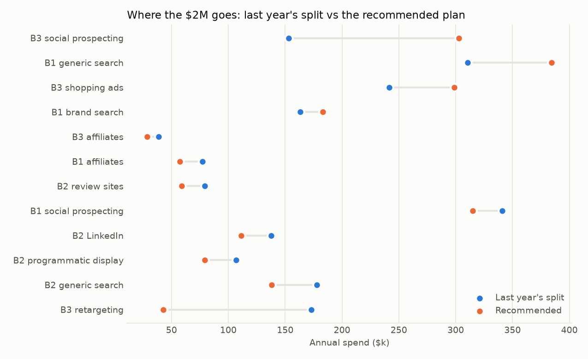

# Budget optimisation (SYNTHETIC data)

## Summary for management

1. **Business question.** How should next year's $2.0M be split across the three businesses and 12
   channels to earn the most long-term contribution, without betting on numbers we cannot trust?
2. **Why it matters.** Last year's split was rolled forward and steered by dashboards. Phases 2 and 3 showed
   that dashboards and history overstate what extra spend achieves, sometimes by a factor of ten.
3. **What this establishes.** The recommended plan moves $301k between channels. The model expects
   **$437k more contribution a year** than last year's split, and its pessimistic case is $409k
   better too. Steering by platform ROAS instead would cost $794k a year by the same model.
   *Evidence: model-based; calibrated to experiments for three lines, the rest from history only.*
4. **In business terms.**
   - Cut: B3 retargeting -$130k, B2 generic search -$40k, B2 programmatic display -$28k, B2 LinkedIn -$27k, B1 social prospecting -$26k, B2 review sites -$20k, B1 affiliates -$20k, B3 affiliates -$10k.
   - Add: B3 social prospecting $150k, B1 generic search $74k, B3 shopping ads $57k, B1 brand search $20k.
   - **B2 has outgrown its sales team.** At last year's spend it would generate more qualified leads than 40 a
     week can absorb, and extra B2 advertising buys leads nobody can call. Removing that limit would be worth
     $409k a year by the model. That is the most extra sales capacity could be worth, before its cost.
   - **Is $2M the right budget?** At the optimum, the last dollar spent brings back $0.77 of contribution and an extra dollar would bring back $0.61. Cutting the budget by $100k would *add* about $23k a year by the model. With today's policies the plan cannot place the full $2M profitably, so the question is not more budget but fewer constraints, or a smaller budget.
5. **Action to consider.** Adopt the plan. Lines without an experiment move at most 25% this year; test the
   biggest uncertain lines next (B1 generic search, B1 social prospecting, B3 shopping ads), then
   re-run this model. Decide on B2 sales capacity separately: it limits B2's growth more than its budget does.
6. **Assumptions and limits.**
   - Response curves for lines without an experiment come from history. They lean optimistic and may rank
     channels wrongly; the 25% guardrail limits the damage.
   - A switch-off test fixes a channel's average effect, not its next-dollar effect.
   - Spend is assumed flat across the year (no seasonal timing), and channels are assumed not to boost each
     other.
   - Customer values are phase 1's estimates. Payback limits use the CFO targets (B3 at 9 months, D-011).

## Method

**Response curves.** One marketing-mix model per business, fitted to 156 weeks:
- weekly customers = organic demand (trend and seasonality) × (1 + the lift from each channel);
- each channel's lift = its maximum × adstock ÷ (adstock + half-saturation spend), with adstock carrying part
  of each week's spend into later weeks.

Three things keep it honest:
- **Calibration.** It must reproduce what the phase 3 budget tests measured, weighted by their precision.
- **Over-dispersion correction.** Weekly counts vary several times more than a simple count model assumes, so
  the history's weight is divided by that factor. Without this, 156 weeks would drown out the experiments.
- **An organic floor.** Organic demand is at least the customers who arrive with no paid last click.

**Uncertainty.** 200 refits, each with random weights on the weeks and test results redrawn
within their error. The optimiser sees all of them.

**Optimiser.** It maximises expected annual contribution (customers the business can serve × 24-month value
− spend), subject to every policy in the table below. The plan's average across the worst 10% of draws must
be no worse than last year's split.

### Does the model reproduce the experiments it was calibrated to?

| experiment       |   measured |   measured_se |   model |   model_p10 |   model_p90 | business   |
|:-----------------|-----------:|--------------:|--------:|------------:|------------:|:-----------|
| brand_search_off |     -0.093 |         0.045 |  -0.107 |      -0.153 |      -0.045 | B1         |
| retargeting_off  |     -0.012 |         0.043 |  -0.018 |      -0.065 |      -0.000 | B3         |
| social_plus_50   |      0.106 |         0.056 |   0.083 |       0.052 |       0.109 | B3         |

## The allocations compared

| line                    |   status_quo |   platform_roas |   uncalibrated_model |   calibrated_point |   recommended |
|:------------------------|-------------:|----------------:|---------------------:|-------------------:|--------------:|
| B1.affiliates           |       77,151 |          19,090 |               57,269 |             57,269 |        57,269 |
| B1.search_brand         |      163,195 |         323,036 |              239,383 |            192,431 |       183,238 |
| B1.search_generic       |      310,665 |         173,527 |              384,341 |            384,341 |       384,341 |
| B1.social_prospecting   |      340,895 |          84,348 |              253,044 |            320,335 |       314,854 |
| B2.linkedin             |      137,806 |         272,781 |              102,293 |            102,293 |       111,176 |
| B2.programmatic_display |      106,897 |          26,450 |               79,349 |             79,349 |        79,349 |
| B2.review_sites         |       79,221 |         117,610 |               58,805 |             58,805 |        58,805 |
| B2.search_generic       |      178,019 |         352,381 |              132,143 |            132,143 |       137,934 |
| B3.affiliates           |       38,594 |           9,549 |               28,648 |             28,648 |        28,648 |
| B3.display_retargeting  |      173,068 |         342,579 |              124,649 |             42,822 |        42,822 |
| B3.shopping             |      241,556 |          59,768 |              298,842 |            298,842 |       298,842 |
| B3.social_prospecting   |      152,933 |         218,882 |              241,234 |            302,722 |       302,722 |

Model view of each allocation (expected and pessimistic are annual incremental contribution after spend;
pessimistic = average of the worst 10% of curve draws):

| allocation         |   expected_profit |   downside_profit |   p90_profit |   incremental_customers |   spend_B1 |   incremental_customers_B1 |   spend_B2 |   incremental_customers_B2 |   spend_B3 |   incremental_customers_B3 |
|:-------------------|------------------:|------------------:|-------------:|------------------------:|-----------:|---------------------------:|-----------:|---------------------------:|-----------:|---------------------------:|
| status_quo         |         1,993,503 |         1,478,885 |    2,140,901 |                  36,410 |    891,906 |                     17,609 |    501,943 |                        266 |    606,150 |                     18,535 |
| platform_roas      |         1,199,530 |           595,162 |    1,456,380 |                  25,946 |    600,000 |                     11,651 |    769,221 |                        265 |    630,779 |                     14,030 |
| uncalibrated_model |         2,342,187 |         1,822,170 |    2,519,808 |                  42,216 |    934,038 |                     19,349 |    372,589 |                        258 |    693,373 |                     22,608 |
| calibrated_point   |         2,427,761 |         1,884,345 |    2,624,929 |                  43,548 |    954,376 |                     19,596 |    372,589 |                        258 |    673,035 |                     23,693 |
| recommended        |         2,430,865 |         1,888,220 |    2,626,979 |                  43,430 |    939,701 |                     19,476 |    387,263 |                        261 |    673,035 |                     23,693 |

By business:

| business   |   spend_last_year_split |   spend_recommended |   customers_last_year_split |   customers_recommended |
|:-----------|------------------------:|--------------------:|----------------------------:|------------------------:|
| B1         |                 891,906 |             939,701 |                      17,609 |                  19,476 |
| B2         |                 501,943 |             387,263 |                         266 |                     261 |
| B3         |                 606,150 |             673,035 |                      18,535 |                  23,693 |

## Where the next dollar works hardest

Contribution per extra dollar (above 1.0 the next dollar pays for itself), with the model's 80% range. At the
optimum, the returns of unconstrained lines converge. Lines held at a floor, ceiling or guardrail do not.

| business   | channel              | tested   |   annual_spend |   marginal_return |   marginal_p10 |   marginal_p90 |   annual_spend_recommended |   marginal_return_recommended |
|:-----------|:---------------------|:---------|---------------:|------------------:|---------------:|---------------:|---------------------------:|------------------------------:|
| B1         | affiliates           | False    |      77,151.16 |              0.16 |           0.00 |           0.65 |                  57,268.81 |                          0.20 |
| B1         | search_brand         | True     |     163,194.70 |              0.79 |           0.31 |           1.29 |                 183,237.60 |                          0.73 |
| B1         | search_generic       | False    |     310,665.12 |              2.42 |           1.90 |           2.92 |                 384,341.19 |                          2.19 |
| B1         | social_prospecting   | False    |     340,895.34 |              0.69 |           0.40 |           0.98 |                 314,853.78 |                          0.73 |
| B2         | linkedin             | False    |     137,806.36 |              0.07 |           0.00 |           0.00 |                 111,176.05 |                          0.75 |
| B2         | programmatic_display | False    |     106,896.62 |              0.01 |           0.00 |           0.00 |                  79,348.67 |                          0.26 |
| B2         | review_sites         | False    |      79,220.72 |              0.07 |           0.00 |           0.00 |                  58,805.03 |                          0.63 |
| B2         | search_generic       | False    |     178,019.50 |              0.15 |           0.00 |           0.00 |                 137,933.65 |                          0.74 |
| B3         | affiliates           | False    |      38,593.83 |              0.13 |           0.00 |           0.00 |                  28,647.95 |                          0.16 |
| B3         | display_retargeting  | True     |     173,068.03 |              0.15 |           0.00 |           0.38 |                  42,822.43 |                          0.33 |
| B3         | shopping             | False    |     241,555.99 |              1.74 |           1.34 |           2.11 |                 298,842.43 |                          1.53 |
| B3         | social_prospecting   | True     |     152,932.63 |              2.07 |           1.38 |           2.76 |                 302,722.42 |                          1.25 |

## What each policy costs

Each policy removed in turn, the plan re-optimised: the gain in expected contribution is what keeping the
policy costs. A cost near zero means the policy does not bind.

| policy                                              | solved   |   expected_profit_gain |   downside_profit_change |
|:----------------------------------------------------|:---------|-----------------------:|-------------------------:|
| B2 sales capacity (40 qualified leads a week)       | True     |                408,947 |                  229,456 |
| +/-25% limit on lines without an experiment         | True     |                268,452 |                  227,218 |
| line floors and ceilings (0.25x-2x last year)       | True     |                 54,485 |                    8,343 |
| business floors and ceilings agreed at acquisition  | True     |                      0 |                        0 |
| B1 brand-search floor (50% of last year)            | True     |                      0 |                        0 |
| concentration caps (25% per line, 50% per business) | True     |                      0 |                        0 |
| keep 90% of each business's customer volume         | True     |                      0 |                        0 |
| payback targets (B1 12, B2 18, B3 9 months)         | True     |                      0 |                        0 |
| pessimistic case no worse than last year's split    | True     |                      0 |                        0 |

The guardrail "costs" $268k by the model's reckoning. That figure is only as good as the model's view of
untested lines.

## What to test next

Untested lines ranked by spend at stake × the width of the model's uncertainty about the next dollar's return:

| business   | channel              |   annual_spend |   marginal_return |   marginal_p10 |   marginal_p90 |      stake |
|:-----------|:---------------------|---------------:|------------------:|---------------:|---------------:|-----------:|
| B1         | search_generic       |     310,665.12 |              2.42 |           1.90 |           2.92 | 316,946.68 |
| B1         | social_prospecting   |     340,895.34 |              0.69 |           0.40 |           0.98 | 196,035.52 |
| B3         | shopping             |     241,555.99 |              1.74 |           1.34 |           2.11 | 184,581.20 |
| B1         | affiliates           |      77,151.16 |              0.16 |           0.00 |           0.65 |  50,241.60 |
| B3         | affiliates           |      38,593.83 |              0.13 |           0.00 |           0.00 |       0.56 |
| B2         | programmatic_display |     106,896.62 |              0.01 |           0.00 |           0.00 |       0.00 |
| B2         | linkedin             |     137,806.36 |              0.07 |           0.00 |           0.00 |       0.00 |
| B2         | search_generic       |     178,019.50 |              0.15 |           0.00 |           0.00 |       0.00 |
| B2         | review_sites         |      79,220.72 |              0.07 |           0.00 |           0.00 |       0.00 |

## Validation against the SYNTHETIC ground truth

What each allocation would *really* earn next year, using the simulation's true curves and customer values.
`true_optimum` is the best split achievable under the same policies (it knows the truth, so no guardrail).

| allocation                    |   model_expected_profit |   true_profit |   true_gain_vs_status_quo | share_of_achievable_gain   |
|:------------------------------|------------------------:|--------------:|--------------------------:|:---------------------------|
| status_quo                    |               1,993,503 |     1,055,809 |                         0 | 0%                         |
| platform_roas                 |               1,199,530 |       251,948 |                  -803,862 | -174%                      |
| uncalibrated_model            |               2,342,187 |     1,182,392 |                   126,583 | 27%                        |
| calibrated_point              |               2,427,761 |     1,334,644 |                   278,835 | 60%                        |
| recommended                   |               2,430,865 |     1,324,104 |                   268,294 | 58%                        |
| true_optimum                  |                     nan |     1,518,772 |                   462,963 | 100%                       |
| recommended_without_guardrail |               2,699,317 |     1,267,008 |                   211,198 | 46%                        |

- The recommended plan really earns **$268k** more than last year's split:
  58% of what perfect knowledge could achieve. The model promised $437k.
  It is optimistic, and the gap is the confounding phase 2 measured.
- Following platform ROAS really loses $804k.
- Without the guardrail the plan earns $211k
  instead of $268k. The model's promised extra from moving untested lines is not real.
- The uncalibrated model's plan earns $127k: calibration to the
  experiments is worth $142k a year here.

### Curve recovery at last year's spend (customers per $1,000 from the next dollar)

The true marginal return lies inside the model's 80% band for 7 of 12 lines
(uncalibrated model: 0 of 12). The bands reflect sampling noise only, not the
confounding that remains in lines no experiment touched. That is why the guardrail exists. For brand search, the
switch-off test pinned down the *average* effect but not the *marginal* one. The next brand test should cut spend
part-way, not switch it off.

| business   | channel              |   weekly_spend |   model_customers |   true_customers |   model_marginal_per_1000 |   model_p10 |   model_p90 |   true_marginal_per_1000 | true_in_80pct_band   |
|:-----------|:---------------------|---------------:|------------------:|-----------------:|--------------------------:|------------:|------------:|-------------------------:|:---------------------|
| B1         | affiliates           |       1,483.68 |              4.65 |            13.41 |                      1.79 |        0.00 |        7.47 |                     4.54 | True                 |
| B1         | search_brand         |       3,138.36 |             43.91 |            39.05 |                      9.05 |        3.54 |       14.76 |                     3.44 | False                |
| B1         | search_generic       |       5,974.33 |            214.29 |           107.51 |                     27.78 |       21.79 |       33.48 |                    12.61 | False                |
| B1         | social_prospecting   |       6,555.68 |             75.78 |           134.09 |                      7.94 |        4.59 |       11.18 |                    17.50 | False                |
| B2         | linkedin             |       2,650.12 |              2.99 |             1.53 |                      0.63 |        0.00 |        1.24 |                     0.47 | True                 |
| B2         | programmatic_display |       2,055.70 |              0.50 |             0.51 |                      0.13 |        0.00 |        0.64 |                     0.14 | True                 |
| B2         | review_sites         |       1,523.48 |              1.01 |             0.87 |                      0.36 |        0.00 |        1.30 |                     0.35 | True                 |
| B2         | search_generic       |       3,423.45 |              2.01 |             1.56 |                      0.34 |        0.00 |        0.91 |                     0.29 | True                 |
| B3         | affiliates           |         742.19 |              2.74 |            11.38 |                      2.17 |        0.00 |        0.00 |                     8.40 | False                |
| B3         | display_retargeting  |       3,328.23 |             14.94 |            31.55 |                      2.60 |        0.00 |        6.38 |                     2.95 | True                 |
| B3         | shopping             |       4,645.31 |            190.40 |           139.09 |                     29.49 |       22.78 |       35.73 |                    18.94 | False                |
| B3         | social_prospecting   |       2,941.01 |            148.37 |            77.67 |                     35.15 |       23.46 |       46.76 |                    28.52 | True                 |
