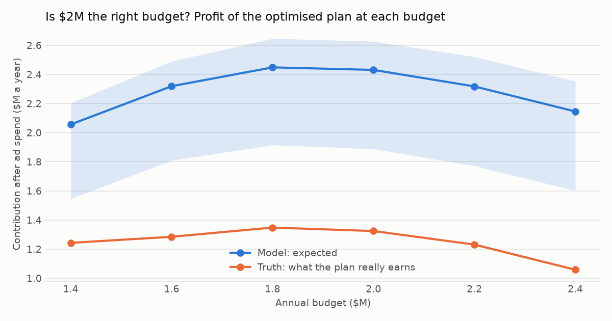
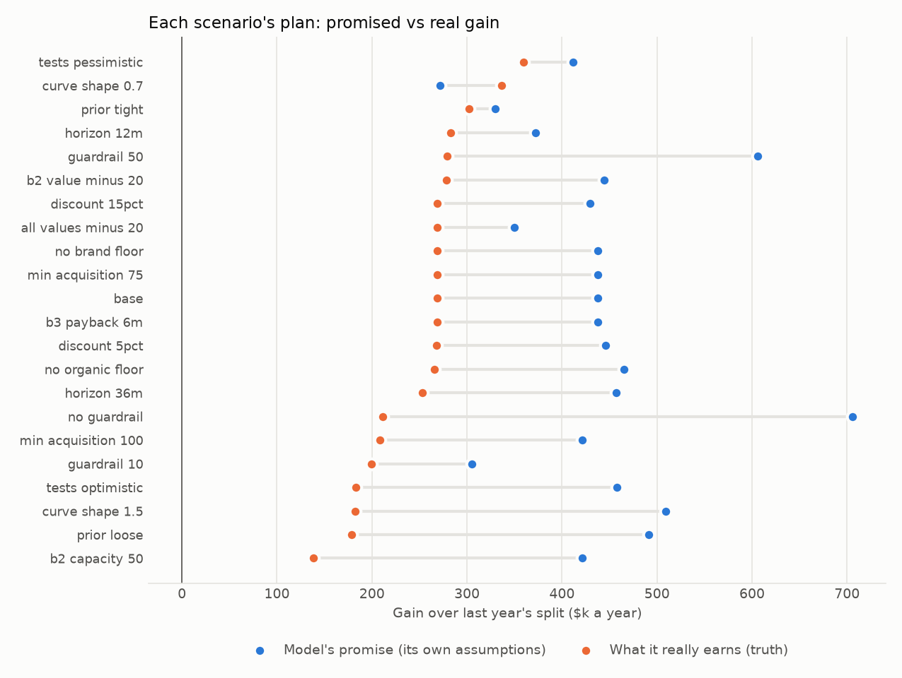

# Sensitivity analysis (SYNTHETIC data)

## Summary for management

1. **Business question.** Which assumptions could change the recommended plan, and which parts of it stand
   whatever we assume?
2. **Why it matters.** Every number in the plan rests on choices: how long a customer is valued, which
   policies bind, how the curves were fitted. A recommendation that flips when one of them moves is a guess.
3. **What this establishes.** The plan was re-optimised under 21 alternative assumptions.
   - **Valuation choices barely change the plan.** On average 0.3% of the budget moves.
   - **Policies** (4.4%) and **how the model was built** (3.1%) matter more.
   - The plan changes most under no guardrail (15%), b2 capacity 50 (7%), guardrail 50 (7%).
4. **In business terms.**
   - **No-regret moves backed by an experiment** (same direction in every scenario): increase
     B3 social prospecting; cut B3 retargeting.
   - **Consistent in every scenario, but resting on history alone:** increase B1 generic search, B3 shopping ads;
     cut B1 affiliates, B2 programmatic display. Every scenario reuses the same history, so this agreement
     is weaker evidence than it looks.
   - **Probably right** (three-quarters of scenarios or more, history only): B1 social prospecting, B2 LinkedIn, B2 review sites, B2 generic search, B3 affiliates.
   - **Depends on assumptions:** B1 brand search. Decide these after the next tests.
   - **Budget:** by the model, profit peaks at about **$1.8M**, earning $17k a
     year more than at $2.0M. Budgets of $2.6M and above cannot be placed within the current policies.
   - **B3 payback at 6 months** (the CFO's original target, relaxed to 9 in D-011): by the model the recommended plan already meets it, unchanged. Cutting retargeting lowers B3's cost per incremental customer enough that the original target becomes reachable.
5. **Action to consider.**
   - Make the experiment-backed moves now, in full.
   - Make the history-only moves within the 25% guardrail. Test the largest of them before going further.
   - Hold the "depends" lines until they have been tested.
   - Treat $2M as a ceiling, not a target, until the untested lines are measured.
   - Do not plan B2 spend around sales capacity that has not been hired.
6. **Assumptions and limits.**
   - Each scenario changes one assumption at a time; combinations can interact.
   - Model scenarios refit with 40 curve draws, not 200.
   - The budget curve keeps every other policy in place.

## Scenarios

Gains are annual incremental contribution after spend, over last year's split at the same budget.
`gain_under_base_assumptions` shows what the scenario's plan earns if the base assumptions are right: the cost of
planning for the wrong world. `base_moves_kept` is the share of the base plan's moves that keep their direction.

| scenario            | group     | description                                                                | solved   |   gain_own_assumptions |   downside_gain_own |   gain_under_base_assumptions |   share_of_budget_moved_vs_base |   base_moves_kept |   spend_B1 |   spend_B2 |   spend_B3 |
|:--------------------|:----------|:---------------------------------------------------------------------------|:---------|-----------------------:|--------------------:|------------------------------:|--------------------------------:|------------------:|-----------:|-----------:|-----------:|
| base                | base      | The recommended plan (phase 4)                                             | True     |             437,362.27 |          409,334.61 |                    437,362.27 |                            0.00 |              1.00 | 939,701.37 | 387,263.40 | 673,035.23 |
| horizon_12m         | valuation | Value customers over 12 months instead of 24                               | True     |             372,060.96 |          331,949.54 |                    435,344.35 |                            0.01 |              1.00 | 952,456.77 | 374,508.01 | 673,035.23 |
| horizon_36m         | valuation | Value customers over 36 months                                             | True     |             457,203.66 |          434,457.58 |                    435,730.57 |                            0.01 |              1.00 | 926,343.62 | 400,621.16 | 673,035.23 |
| discount_5pct       | valuation | Discount rate 5% instead of 10%                                            | True     |             445,869.98 |          418,112.11 |                    437,358.63 |                            0.00 |              1.00 | 939,427.62 | 387,537.15 | 673,035.23 |
| discount_15pct      | valuation | Discount rate 15%                                                          | True     |             429,593.87 |          401,192.11 |                    437,361.26 |                            0.00 |              1.00 | 939,801.17 | 387,163.61 | 673,035.23 |
| b2_value_minus_20   | valuation | B2 customers worth 20% less                                                | True     |             444,138.66 |          405,543.29 |                    436,787.19 |                            0.00 |              1.00 | 948,390.53 | 378,574.25 | 673,035.23 |
| all_values_minus_20 | valuation | Every customer worth 20% less                                              | True     |             349,889.81 |          327,467.62 |                    437,362.27 |                            0.00 |              1.00 | 939,701.36 | 387,263.41 | 673,035.22 |
| b3_payback_6m       | policy    | B3 payback within 6 months (the CFO's original target, D-011)              | True     |             437,362.27 |          409,334.61 |                    437,362.27 |                            0.00 |              1.00 | 939,701.37 | 387,263.40 | 673,035.23 |
| no_brand_floor      | policy    | No 50% floor on B1 brand search                                            | True     |             437,362.27 |          409,334.61 |                    437,362.27 |                            0.00 |              1.00 | 939,701.37 | 387,263.40 | 673,035.23 |
| min_acquisition_100 | policy    | Keep 100% of each business's customer volume                               | True     |             421,582.81 |          384,503.44 |                    421,582.81 |                            0.03 |              1.00 | 889,070.04 | 437,894.74 | 673,035.23 |
| min_acquisition_75  | policy    | Keep only 75% of customer volume                                           | True     |             437,362.27 |          409,334.61 |                    437,362.27 |                            0.00 |              1.00 | 939,701.37 | 387,263.40 | 673,035.23 |
| guardrail_10        | policy    | Untested lines move at most 10%                                            | True     |             305,131.24 |          272,758.43 |                    305,131.24 |                            0.04 |              1.00 | 909,989.24 | 447,107.04 | 642,903.72 |
| guardrail_50        | policy    | Untested lines move up to 50%                                              | True     |             605,665.40 |          564,884.63 |                    605,665.40 |                            0.07 |              0.92 | 917,497.36 | 359,248.25 | 723,254.39 |
| no_guardrail        | policy    | No limit on untested lines                                                 | True     |             705,814.15 |          636,553.07 |                    705,814.15 |                            0.15 |              0.92 | 816,757.95 | 350,000.00 | 833,242.05 |
| b2_capacity_50      | policy    | B2 sales capacity 50 qualified leads a week (one more hire)                | True     |             421,205.67 |          384,229.25 |                    352,167.09 |                            0.07 |              0.67 | 798,338.08 | 528,626.69 | 673,035.23 |
| tests_optimistic    | model     | Every experiment at the end of its 95% range where channels are worth more | True     |             457,549.43 |          369,144.77 |                    423,761.15 |                            0.04 |              1.00 | 946,295.82 | 375,578.52 | 678,125.66 |
| tests_pessimistic   | model     | Every experiment at the end where channels are worth less                  | True     |             411,889.71 |          436,433.51 |                    400,879.01 |                            0.05 |              0.75 | 922,337.99 | 385,528.15 | 692,133.86 |
| curve_shape_0.7     | model     | Sharper diminishing returns (curve shape 0.7)                              | True     |             271,334.90 |          232,213.81 |                    430,480.27 |                            0.03 |              0.83 | 954,375.57 | 372,589.20 | 673,035.23 |
| curve_shape_1.5     | model     | S-shaped curves (shape 1.5): weak at low spend                             | True     |             509,036.50 |          437,052.31 |                    420,166.76 |                            0.03 |              0.92 | 920,984.06 | 393,503.73 | 685,512.21 |
| no_organic_floor    | model     | No floor on organic demand                                                 | True     |             465,379.51 |          433,116.84 |                    423,054.78 |                            0.02 |              0.83 | 913,669.22 | 394,196.92 | 692,133.86 |
| prior_tight         | model     | Half-saturation held close to average spend (prior sd 0.5)                 | True     |             329,509.16 |          284,209.87 |                    435,304.99 |                            0.01 |              0.83 | 941,814.03 | 385,150.75 | 673,035.23 |
| prior_loose         | model     | Half-saturation left nearly free (prior sd 3)                              | True     |             491,043.74 |          426,851.36 |                    427,681.15 |                            0.03 |              1.00 | 940,783.87 | 386,180.91 | 673,035.23 |

## Line by line: which moves survive every assumption

Change from last year's split in the base plan, and the range across all scenarios (budget fixed at $2M).

| line                    |   base_change |   lowest_change |   highest_change |   share_increase |   share_cut | verdict                | evidence     |
|:------------------------|--------------:|----------------:|-----------------:|-----------------:|------------:|:-----------------------|:-------------|
| B1 affiliates           |         -0.26 |           -0.75 |            -0.11 |             0.00 |        1.00 | no-regret cut          | history only |
| B1 brand search         |          0.12 |           -0.51 |             0.54 |             0.64 |        0.18 | depends on assumptions | experiment   |
| B1 generic search       |          0.24 |            0.09 |             0.61 |             1.00 |        0.00 | no-regret increase     | history only |
| B1 social prospecting   |         -0.08 |           -0.48 |             0.17 |             0.09 |        0.86 | mostly cut             | history only |
| B2 LinkedIn             |         -0.19 |           -0.26 |             0.24 |             0.05 |        0.95 | mostly cut             | history only |
| B2 programmatic display |         -0.26 |           -0.61 |            -0.11 |             0.00 |        1.00 | no-regret cut          | history only |
| B2 review sites         |         -0.26 |           -0.29 |             0.14 |             0.05 |        0.95 | mostly cut             | history only |
| B2 generic search       |         -0.23 |           -0.26 |             0.06 |             0.05 |        0.95 | mostly cut             | history only |
| B3 affiliates           |         -0.26 |           -0.75 |             0.24 |             0.14 |        0.86 | mostly cut             | history only |
| B3 retargeting          |         -0.75 |           -0.75 |            -0.72 |             0.00 |        1.00 | no-regret cut          | experiment   |
| B3 shopping ads         |          0.24 |            0.09 |             0.98 |             1.00 |        0.00 | no-regret increase     | history only |
| B3 social prospecting   |          0.98 |            0.98 |             0.98 |             1.00 |        0.00 | no-regret increase     | experiment   |

## Budget curve

|    budget | solved   |   expected_profit |   downside_profit |   p90_profit |   incremental_customers |
|----------:|:---------|------------------:|------------------:|-------------:|------------------------:|
| 1,400,000 | True     |         2,056,123 |         1,546,563 |    2,203,181 |                  29,891 |
| 1,600,000 | True     |         2,318,926 |         1,809,342 |    2,490,076 |                  35,760 |
| 1,800,000 | True     |         2,448,186 |         1,915,181 |    2,646,135 |                  41,340 |
| 2,000,000 | True     |         2,430,865 |         1,888,220 |    2,626,979 |                  43,430 |
| 2,200,000 | True     |         2,317,525 |         1,771,165 |    2,520,866 |                  44,281 |
| 2,400,000 | True     |         2,145,408 |         1,601,892 |    2,353,790 |                  44,626 |
| 2,600,000 | False    |               nan |               nan |          nan |                     nan |
| 2,800,000 | False    |               nan |               nan |          nan |                     nan |

## Validation against the SYNTHETIC ground truth

**No-regret verdicts:** 6 of 6 point the same way as the true optimum. "Mostly"
verdicts: 3 of 5 (wrong: B1 social prospecting, B2 LinkedIn, both untested lines). Agreement across
scenarios is good evidence where experiments anchor the lines, and weaker where they do not.

| line                    |   base_change |   lowest_change |   highest_change |   share_increase |   share_cut | verdict                | evidence     |   true_optimum_change |   direction_right |
|:------------------------|--------------:|----------------:|-----------------:|-----------------:|------------:|:-----------------------|:-------------|----------------------:|------------------:|
| B1.affiliates           |         -0.26 |           -0.75 |            -0.11 |             0.00 |        1.00 | no-regret cut          | history only |                 -0.75 |              1.00 |
| B1.search_brand         |          0.12 |           -0.51 |             0.54 |             0.64 |        0.18 | depends on assumptions | experiment   |                 -0.51 |            nan    |
| B1.search_generic       |          0.24 |            0.09 |             0.61 |             1.00 |        0.00 | no-regret increase     | history only |                  0.27 |              1.00 |
| B1.social_prospecting   |         -0.08 |           -0.48 |             0.17 |             0.09 |        0.86 | mostly cut             | history only |                  0.47 |              0.00 |
| B2.linkedin             |         -0.19 |           -0.26 |             0.24 |             0.05 |        0.95 | mostly cut             | history only |                  0.24 |              0.00 |
| B2.programmatic_display |         -0.26 |           -0.61 |            -0.11 |             0.00 |        1.00 | no-regret cut          | history only |                 -0.75 |              1.00 |
| B2.review_sites         |         -0.26 |           -0.29 |             0.14 |             0.05 |        0.95 | mostly cut             | history only |                 -0.23 |              1.00 |
| B2.search_generic       |         -0.23 |           -0.26 |             0.06 |             0.05 |        0.95 | mostly cut             | history only |                 -0.48 |              1.00 |
| B3.affiliates           |         -0.26 |           -0.75 |             0.24 |             0.14 |        0.86 | mostly cut             | history only |                 -0.73 |              1.00 |
| B3.display_retargeting  |         -0.75 |           -0.75 |            -0.72 |             0.00 |        1.00 | no-regret cut          | experiment   |                 -0.75 |              1.00 |
| B3.shopping             |          0.24 |            0.09 |             0.98 |             1.00 |        0.00 | no-regret increase     | history only |                  0.24 |              1.00 |
| B3.social_prospecting   |          0.98 |            0.98 |             0.98 |             1.00 |        0.00 | no-regret increase     | experiment   |                  0.98 |              1.00 |

**Budget:** the model's plan really earns most at **$1.8M**; the best achievable allocation peaks at
$2.0M. The model's advice to spend less than $2M is right about its own plan, and the truth shows that
a better plan could use more.

|    budget |   true_profit_of_model_plan |   true_profit_of_last_years_split |   true_best_achievable |
|----------:|----------------------------:|----------------------------------:|-----------------------:|
| 1,400,000 |                   1,242,752 |                         1,135,636 |              1,363,716 |
| 1,600,000 |                   1,284,672 |                         1,135,236 |              1,450,637 |
| 1,800,000 |                   1,347,834 |                         1,100,133 |              1,507,133 |
| 2,000,000 |                   1,324,104 |                         1,055,809 |              1,518,772 |
| 2,200,000 |                   1,230,920 |                         1,003,005 |              1,471,282 |
| 2,400,000 |                   1,058,052 |                           942,374 |              1,299,081 |
| 2,600,000 |                         nan |                           874,500 |              1,099,751 |
| 2,800,000 |                         nan |                           799,907 |                    nan |

**Scenario plans in reality** (true gain over last year's split; base $268k):

- Planning for a B2 sales capacity of 50 that has not been hired really earns $138k.
- Reading the experiments at their pessimistic end earns $359k; at their
  optimistic end, $183k. The model leans optimistic, so caution pays.
- The guardrail at 10%, 25% (base), 50% and none: $199k, $268k,
  $279k, $211k.

**Payback of the recommended plan in reality:** every business meets its target; B3 pays back in
4 months, inside even the original 6-month target.

| business   |   true_payback_months |   target_months |   true_incremental_cac |   model_incremental_cac |   true_cac_limit_for_target | meets_target_in_truth   |
|:-----------|----------------------:|----------------:|-----------------------:|------------------------:|----------------------------:|:------------------------|
| B1         |                   9.0 |              12 |                   60.0 |                    48.3 |                        72.5 | True                    |
| B2         |                  10.0 |              18 |                2,104.1 |                 1,485.8 |                     4,143.7 | True                    |
| B3         |                   4.0 |               9 |                   38.5 |                    28.4 |                        47.0 | True                    |
